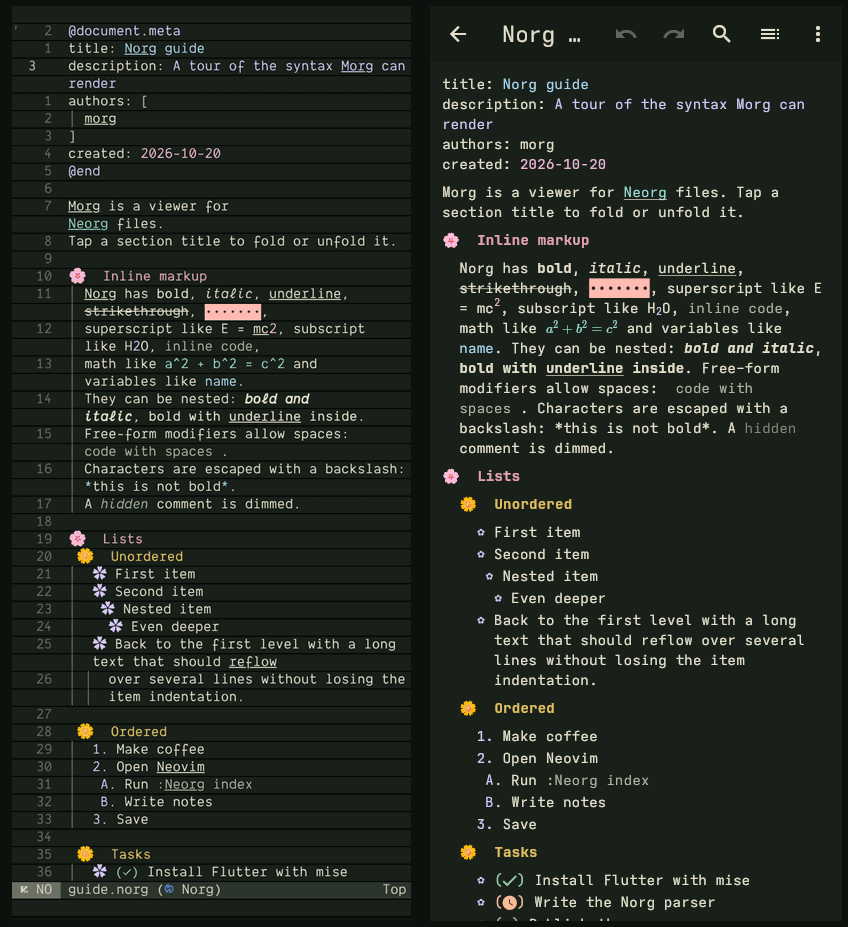
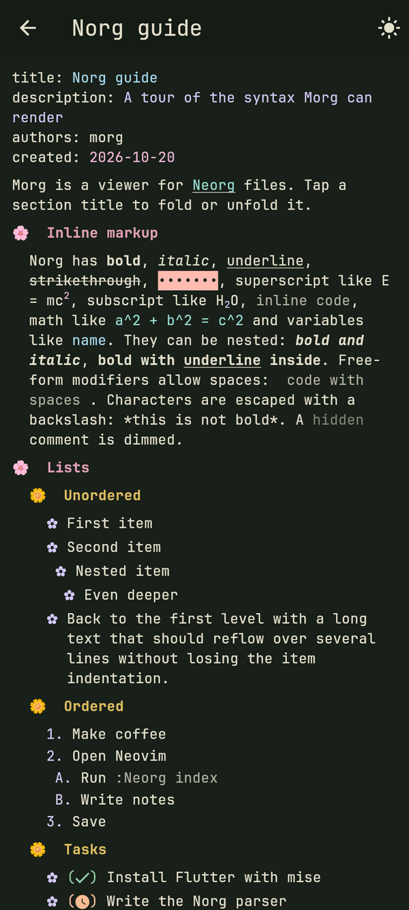
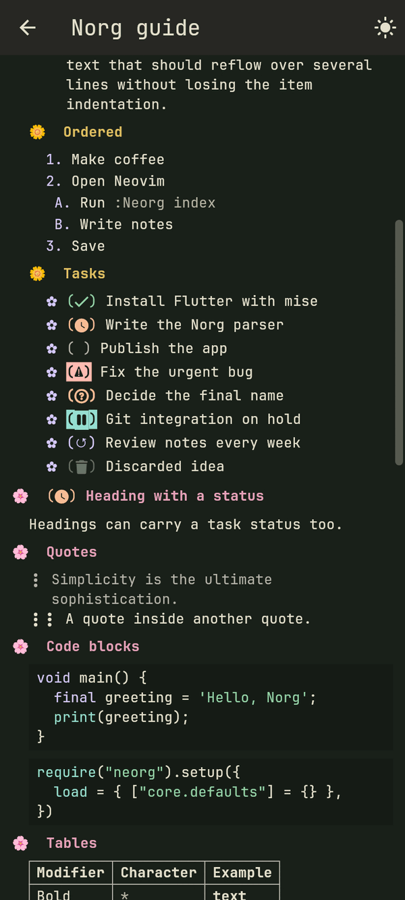
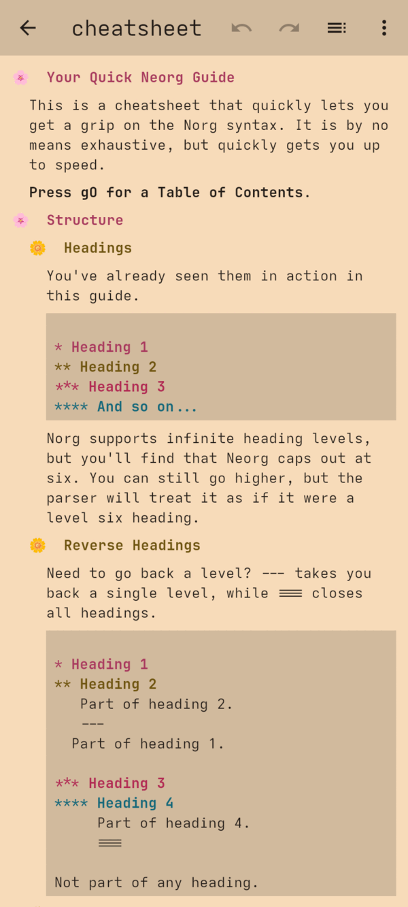
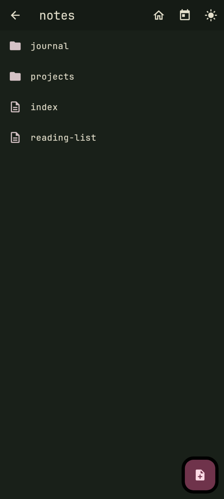

<p align="center">
  
</p>

<h1 align="center">Morg</h1>

<p align="center">
  <b>Mobile org</b> — a fast viewer and editor for <a href="https://github.com/nvim-neorg/neorg">Neorg</a> notes on Android,
  rendered the way your Neovim shows them.
</p>

<p align="center">
  <a href="https://github.com/CRAG666/Morg/releases/latest">Download the latest release</a>
</p>



<p align="center">
  
  
  
  
</p>

## Features

- **Norg parser written in Dart**: headings, lists, quotes, TODO states, definitions, footnotes, ranged and
  verbatim tags (`@code`, `@table`, `@math`, `@image`, `@document.meta`, `|details`, `|comment`), infirm tags
  (`.toc`, `.image`, including SVG), carryover tags (`#name`, `#comment`), task extensions with priorities and
  dates on every detached modifier, delimiters, and all inline markup, including link and free-form modifiers.
- **LaTeX math**: inline `$…$` and `@math` blocks are typeset, not shown as source.
- **Faithful to `core.concealer`**: the same icons, ordered-list formats and TODO glyphs as neorg, and the colors
  of *your* Neovim colorscheme (export it with one command, see [Themes](#themes)).
- **Configured like neorg**: `morg.json` has the same structure as `require("neorg").setup()`
  (`core.concealer`, `core.dirman`, `core.esupports.metagen`, `core.esupports.indent`, `core.journal`).
- **Workspaces**: local folders (for example synced with Syncthing) and cloud folders through Android's Storage
  Access Framework (Nextcloud, OneDrive, …). Links resolve like `core.esupports.hop`: `$/`, `$name/`, `~/`,
  absolute and relative paths, `{* Heading}`, `{$ definition}`, `{^ footnote}`, `{# generic}` (also `#name`
  tags and `<targets>`), anchors (`[name]`), `{/ external.pdf}`, `file://` and URLs.
- **Edit in place, like `conceallevel=2`**: tap any element and only that element shows its raw Norg source,
  still highlighted (delimiters dimmed like Neovim's insert mode), ready to edit; tap elsewhere to save.
  Tap a heading icon to fold it.
- **Tasks**: tap a TODO to cycle it, long-press it to pick any of the eight states or a due date
  (`< Sat, 29 Oct 2026`), swipe right to advance it and left to delete it. Children and parents are updated like
  `core.qol.todo_items`, and tasks with subtasks show `[done/total] (progress%)` like `core.todo-introspector`.
- **Structure editing**: long-press a heading icon or a list bullet to focus on it (narrowing), promote or demote
  it with its children, move it up or down among its siblings, switch a list between bullets and numbers, turn it
  into a task or delete it (`core.promo`, `core.text-objects`, `core.pivot`). Every change can be undone and redone.
- **Writing**: lists and quotes continue when you press Enter, like `core.itero` (an empty item ends the list),
  and typing `{` suggests headings, definitions, footnotes and the files of the workspace. Edit the whole file,
  `updated:` is refreshed on save like metagen.
- **Formatting like `core.esupports.indent`**: the lines you change are reindented with neorg's rules (content
  under the column of its heading's title, list continuations under the item text, `@end` under its tag), and
  **⋮ → Format file** reindents the whole note like `gg=G` in Neovim.
- **Workspace search, task list and agenda**: search every note (smart case, `a|b` for alternatives), list all
  tasks by state, and see dated tasks (`<` due, `>` start, `@` timestamp) by day with overdue ones first.
- **Journal and summaries**: open today's, any date's, the previous or the next journal entry (`core.journal`),
  and generate a `summary.norg` of the workspace grouped by `categories:` (`core.summary`).
- **Outline and export**: a side panel lists every heading (`core.qol.toc`), and notes export to Markdown
  (`core.export`).
- **Workspaces from the UI**: add, rename, relocate or remove them; opening a workspace opens its `index.norg`,
  like `:Neorg workspace`.
- **Blazing fast**: a linear-time parser (~65 MiB/s) and a virtualized document view that only builds what is
  on screen, no matter how long the note is.
- **Neorg's own documentation built in**: the home screen opens the Neorg help page and the quick Norg guide
  (cheatsheet) shipped with neorg, rendered by Morg.
- English and Spanish interface, chosen in **Settings → Language** (follows the system by default).

## Install

Download `Morg-vX.Y.Z.apk` from the [latest release](https://github.com/CRAG666/Morg/releases/latest). It works
on every Android architecture, and new releases are signed with the same key, so they install over the previous
version.

On first launch grant **File access** if you keep your notes in a regular folder (Syncthing, local storage), then
tap **Add workspace** and choose the folder. Cloud folders work without that permission.

## Using Morg

Morg mirrors what you do in Neovim with taps and gestures. Try them on the bundled **Neorg help page**: it opens
from the home screen, and nothing you change there is saved.

### Reading

| Gesture | What it does |
|---|---|
| Tap a link | Follows it: headings, definitions, footnotes and anchors jump inside the note; other notes, files and URLs open |
| Tap a heading icon | Folds or unfolds the heading (a folded heading ends with `…`) |
| Tap **Outline** in the top bar | Lists every heading; tap one to jump to it |
| Long-press a heading icon → **Focus** | Shows only that heading and its children; the × in the bar or *back* shows everything again |
| Long-press any text | Selects it; drag the handles to extend the selection across elements. Copied text has one element per line, without the decorative icons, and task states as Norg characters (`(x) done`) |

### Editing

| Gesture | What it does |
|---|---|
| Tap an element (paragraph, heading, list item, block) | Shows its Norg source, highlighted, ready to edit; tap outside to save |
| Enter at the end of a list item or quote | Starts the next item (`( )` included for tasks); Enter on an empty item ends the list |
| Type `{` | Suggests headings, definitions, footnotes and workspace files; tap one to insert the link |
| **Undo** / **Redo** (top bar) | Reverts or repeats the last changes made in the app |
| ⋮ → **Edit** | Edits the whole file as plain text |
| ⋮ → **Format file** | Reindents the whole note like `gg=G` in Neovim; **Undo** in the notice reverts it |

Every change made in the app is reindented with neorg's rules, but only the lines it touches (and the element or
heading they belong to), like neorg does when you press Enter or Esc. Turn it off in **Settings → Notes → Format
edited lines** (`core.esupports.indent.config.format_on_escape`); **Remove extra indentation** (`dedent_excess`)
controls whether lines indented too far to the right are moved back.

### Tasks

| Gesture | What it does |
|---|---|
| Tap the `( )` of a task | Cycles it like neorg: undone → done → pending |
| Long-press the `( )` | Picks any of the eight states, or sets or removes a due date |
| Swipe a task to the right | Advances its state |
| Swipe a task to the left | Deletes it (and its children); **Undo** in the notice brings it back |

Children follow their parent and parents are recomputed from their children, as in `core.qol.todo_items`. A task
with subtasks shows its progress, `[2/5] (40%)`.

### Structure

Long-press a **heading icon** or a **list bullet**, or the empty space to its left, to open the element menu:

- **Focus** (headings only).
- **Promote** / **Demote** the element and its children.
- **Move up** / **Move down** among its siblings, with its children.
- **Make it a numbered list** / **Make it a bulleted list**, for the whole list level.
- **Make it a task**.
- **Delete**.

### Workspace

| Where | What it does |
|---|---|
| **Search** in a note or in the file browser | Searches every note (lowercase ignores case, `a\|b` matches either), shows the **Agenda** of dated tasks (overdue first, then by day) and the **Tasks** of the workspace filtered by state. Results come instantly from an index kept on the phone; only notes that changed since the last scan are read again (the bar under the tabs shows it), and **Refresh** rescans on demand |
| **Agenda** in the file browser | Opens the agenda directly |
| ⋮ in a note | **New note** (in the workspace root, like `core.dirman`; type `folder/name` for a subfolder), **Journal** of today or of any date, the previous or next day when the note is a journal entry, and **Export to Markdown** |
| **+** in the file browser (⋮ → **Browse files**) | **New note** in the folder you are browsing |
| ⋮ → **Delete note** in a note, or long-press a file in the file browser | Deletes the note after confirming; **Undo** in the notice restores it with the same content |
| ⋮ in the file browser | **Journal for a date…** and **Workspace summary**, which writes `summary.norg` with every note grouped by `categories:` |

Dates use the Norg timestamp format from the specification: `(< Sat, 29 Oct 2026)` is a due date,
`(> …)` a start date and `(@ …)` a timestamp; ISO dates like `2026-10-29` work too.

## Configuration

Everything can be changed in **Settings** (language, theme, colorscheme, concealer icons, author, index file, default
workspace and journal options). Those screens edit `morg.json`, which you can also edit directly in
**Settings → Edit configuration** or replace with **Import configuration** (for example from your synced notes).
Invalid configurations are rejected before they are saved.

```json
{
  "theme": "eyes",
  "theme_mode": "system",
  "language": "system",
  "load": {
    "core.concealer": {
      "config": {
        "icons": {
          "heading": { "icons": ["🌸 ", "🌼 ", "🌺 ", "💠 ", "💮 ", "🪷 "] },
          "list": { "icons": ["✿"] },
          "code_block": { "conceal": true }
        }
      }
    },
    "core.dirman": {
      "config": {
        "workspaces": {
          "notes": "~/Documents/Notes",
          "work": "content://com.android.externalstorage.documents/tree/…"
        },
        "index": "index.norg"
      }
    },
    "core.esupports.metagen": { "config": { "author": "me" } },
    "core.journal": { "config": { "journal_folder": "journal", "strategy": "nested" } }
  }
}
```

- Keys and defaults follow neorg; anything you leave out uses neorg's default (`basic` icon preset).
- `theme`, `theme_mode` (`system`, `light`, `dark`) and `language` (`system`, `en`, `es`) are the only keys outside
  neorg's structure.
- On Android `~` is the shared storage root (`/storage/emulated/0`).
- Use the **same workspace names as in Neovim** so links like `{:$notes/index:}` keep working.
- If a workspace folder is missing on the phone, tap it to pick its location; the name is kept.

### Themes

Morg reads colors from the `@neorg.*` highlight groups (and the treesitter groups for code blocks) of a Neovim
colorscheme. To use yours:

```sh
nvim --headless -c 'luafile tool/export_nvim_theme.lua' any-file.norg   # writes <colorscheme>.json
```

Then **Settings → Import Neovim theme**, and set `"theme": "<colorscheme>"` in `morg.json`. The dark and light
variants are exported together. The bundled default is `eyes`.

## Contributing

Contributions are welcome. Please keep commits, comments and documentation in English.

### Setup

The toolchain is pinned with [mise](https://mise.jdx.dev) in `mise.toml` (Flutter, Java, Android SDK):

```sh
mise install
mise exec -- flutter pub get
mise exec -- flutter run            # on a device, or -d linux / -d chrome
```

### Before opening a pull request

```sh
mise exec -- dart format lib tool
mise exec -- flutter analyze        # must report "No issues found!"
mise exec -- flutter build apk --debug
mise exec -- flutter build web      # cloud folders are stubbed out on the web
```

### Guidelines

- **KISS and DRY.** Prefer the smallest change that solves the problem; extract shared code instead of copying it.
- **Libraries first.** Before writing a parser, list, picker or similar, look for a maintained package on
  [pub.dev](https://pub.dev) and check its version and activity.
- **Measure before optimizing.** `dart run tool/bench_parser.dart <notes-dir>` reports parser throughput
  (compile it with `dart compile exe` for realistic numbers). Keep the parser linear-time and the document view
  virtualized.
- **Parser changes must not change output by accident.** Compare the AST of a corpus of real notes before and
  after the change, and fuzz the new parser against the old one with random inputs full of markup characters.
- **Follow neorg.** When behaviour is unclear, read the neorg sources (`core.concealer`, `core.dirman`,
  `core.esupports.hop`, `core.qol.todo_items`, …) and do what they do.
- **User-facing text** lives in `lib/l10n/app_en.arb` (template) and `lib/l10n/app_es.arb`; run
  `flutter gen-l10n` after editing them.

### Project layout

```
lib/
  norg/            parser (ast.dart, parser.dart) and source edits (TODO cycling, metagen)
  norg_view.dart   virtualized renderer that mimics core.concealer
  config/          concealer configuration with neorg's defaults
  theme/           Neovim highlight groups → Flutter text styles
  highlight/       code highlighting languages (re_highlight) and a BibTeX grammar
  workspace/       note stores (local files and Android SAF) and link resolution
  l10n/            translations
  *_screen.dart    home, workspace browser, document, editor and settings screens
assets/            default config, bundled theme, fonts, Neorg docs and icon sources
tool/              Neovim theme exporter and parser benchmark
```

### Releasing

1. Bump `version:` in `pubspec.yaml`.
2. Commit, then push a tag that matches it: `git tag -a v0.2.0 -m "Morg v0.2.0" && git push origin v0.2.0`.

The [release workflow](.github/workflows/release.yml) checks that the tag matches `pubspec.yaml`, builds the
signed universal APK and publishes the release. It needs the `KEYSTORE_BASE64` and `KEYSTORE_PASSWORD`
repository secrets.

## Acknowledgements

- [Neorg](https://github.com/nvim-neorg/neorg) and the [Norg specification](https://github.com/nvim-neorg/norg-specs).
  `assets/docs/neorg.norg` and `assets/docs/cheatsheet.norg` are Neorg's documentation (GPL-3.0).
- [JetBrains Mono](https://www.jetbrains.com/lp/mono/) (OFL) and the
  [Nerd Fonts](https://www.nerdfonts.com) symbols (MIT); their licenses are in `assets/fonts/`.
- [re_highlight](https://pub.dev/packages/re_highlight), [super_sliver_list](https://pub.dev/packages/super_sliver_list),
  [flutter_math_fork](https://pub.dev/packages/flutter_math_fork), [jovial_svg](https://pub.dev/packages/jovial_svg),
  [saf_util](https://pub.dev/packages/saf_util), [saf_stream](https://pub.dev/packages/saf_stream) and the other
  packages listed in `pubspec.yaml`.
